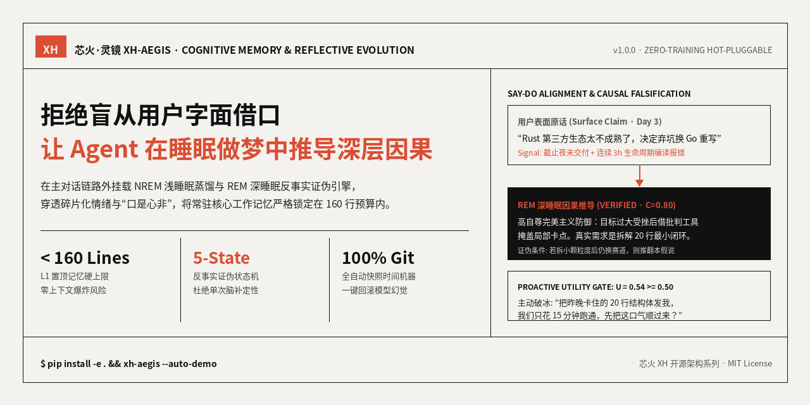
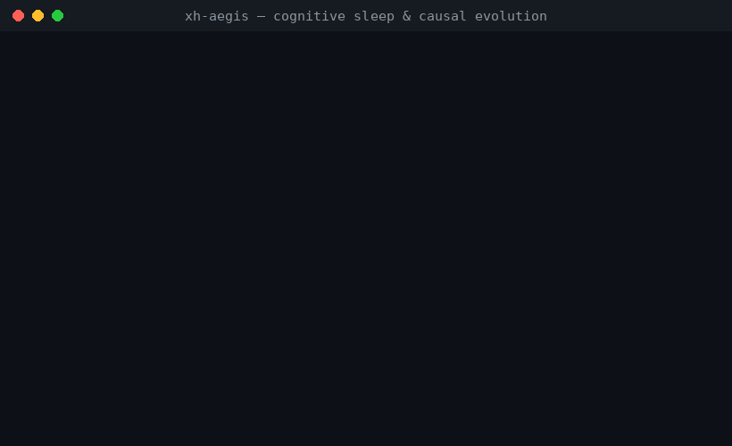
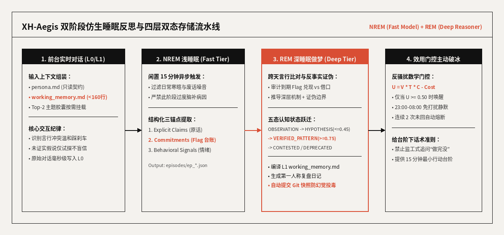

<div align="center">

</div>

# 🔥 芯火·灵镜 XH-Aegis (`xh-aegis`)

*Zero-training, hot-pluggable cognitive memory and bio-inspired NREM/REM causal reflection engine for autonomous LLM agents.*

**给它一段碎片化、甚至“口是心非”的日常对话流，它在后台离线睡眠中自动比对跨天言行、识破表面借口、推演出带反事实证伪边界的深层因果画像，并将常驻核心记忆严格锁定在 160 行以内。**

[中文](README.md) · [English](README_EN.md) · [AI 索引 (llms.txt)](llms.txt) · [审计报告 (REPO-AUDIT)](REPO-AUDIT.md)

[](https://github.com/Dragon-01-you/xh-aegis/actions)
[](LICENSE)
[](pyproject.toml)
[](CHANGELOG.md)
[](REPO-AUDIT.md)
[](https://github.com/Dragon-01-you/xh-aegis)

---

## 这是什么（说人话）

普通 Agent 的记忆系统像一台“复读机”：用户今天受挫抱怨一句“Rust 生态太差了，我不学了改学 Go”，普通向量库或摘要记忆就会老老实实记下“用户偏好 Go 语言”，从此顺着用户的逃避借口把路带偏。

**芯火·灵镜 XH-Aegis (`xh-aegis`，命令 `xh-aegis` / `xh`，兼容旧名 `cognitive_memory_agent`)** 是一套挂载在主对话链路之外的**仿生睡眠反思与因果进化系统**：给它用户的多日对话切片与历史承诺（Flag），它在闲置时像人类睡眠做梦一样复盘，输出**经过言行一致性校验的 L1 核心工作记忆（`< 160` 行）、带证伪条件的 L2 因果信念库（`causal_beliefs.json`）以及克制有温度的主动破冰消息**。

### 它能回答 5 个核心问题

| # | 用户与开发者真实会问的问题 | `xh-aegis` 怎么回答 |
|:---:|---|---|
| 1 | 为什么 Agent 总是盲从用户的字面借口，用户一畏难想弃坑它就跟着换方向？ | 后台 REM 引擎专门对比 `commitments.json`（历史立下的 Flag）与当晚报错/挫败信号，将借口弃坑标为 `ABANDONED_WITH_EXCUSE`，在前台对话中温和踩刹车 |
| 2 | 让大模型推导深层心理动机，怎么防止它“过度脑补”给用户乱贴死标签？ | 强制执行**五态反事实证伪状态机**：单次推演只能存为 `HYPOTHESIS`（置信度 $\le 0.45$），且必须写明 `falsification_condition`（出现什么反例就推翻该假说） |
| 3 | 长期运行几个月后，记忆文件会不会撑爆上下文窗口导致 Token 费用失控？ | 采用 **JSON 主存储 + Markdown 确定性编译**：`working_memory.md` 硬编码锁定在 $\le 160$ 行红线内，冷档案按需检索 Top-2 主题胶囊 |
| 4 | 如果后台做梦某次推理抽风，把长期记忆污染了怎么办？ | 每次 REM 周期更新记忆后自动调用 Git 底层命令生成 `[REM-Cycle]` 快照，支持 `/rollback` 一键无损回退到任意历史认知节点 |
| 5 | 怎么让 Agent 主动找我聊天，但又不会变成烦人的“定时闹钟监工”？ | 引入唤醒净效用公式 $U_{\text{wake}} = V \times T \times C - \text{Cost} \ge 0.50$，叠加 23:00–08:00 免打扰窗口与连续 2 次未回自动静默熔断 |

---

## 30 秒演示

<div align="center">

</div>

上方终端 GIF 为 `xh-aegis --auto-demo` 的真实运行浓缩回放：完整展示了从 **Day 1 亢奋立下 Rust 重构大 Flag** $\to$ **Day 3 编译受挫 3 小时后借口“生态不成熟”想换 Go** $\to$ **深夜 REM 做梦提出“完美主义大目标防御”假说（初始置信度 0.45，仅作待检验假说）并提交做梦前/后两个 Git 快照** $\to$ **Day 4 晚间效用门控 $U=0.54 \ge 0.50$ 触发低压力破冰** $\to$ **Day 5 用户死磕调通，新证据按固定幅度入账（0.45→0.67），仍未达到晋升门槛，继续观察** 的全闭环。

---

## 目录

- [这是什么（说人话）](#这是什么说人话)
- [30 秒演示](#30-秒演示)
- [快速开始](#快速开始)
- [工作原理](#工作原理)
- [技术实现](#技术实现)
- [对比同类项目](#对比同类项目)
- [实际案例（脱敏）](#实际案例脱敏)
- [常见问题](#常见问题)
- [路线图](#路线图)
- [参与贡献](#参与贡献)
- [使用须知与免责声明](#使用须知与免责声明)
- [Star 历史](#star-历史)

---

## 快速开始

### 环境要求

| 依赖项 | 版本要求 | 说明 |
|:---:|:---:|---|
| Python | `>= 3.10` | 核心状态机、Git 快照时间机器与离线仿真零第三方重依赖 |
| PyYAML | `>= 6.0` | 加载 `config/settings.yaml` 与分离式 Prompt 模板库 |
| Git | `>= 2.20` | 用于 `data/` 目录全自动防幻觉快照与 `/rollback` 回滚 |
| LLM API | 可选 (`OPENAI_API_KEY`) | 默认内置确定性高拟真回放；配置环境变量即可无缝切换 OpenAI / DeepSeek / Ollama |

### 三步上手

```bash
# 1. 克隆仓库并安装 xh-aegis 命令行工具
git clone https://github.com/Dragon-01-you/xh-aegis.git
cd xh-aegis
pip install -e .

# 2. 一键运行 5 天跨周期言行比对、REM 做梦与反事实证伪演示（零外部 API 消耗）
xh-aegis --auto-demo

# 3. 运行单元测试或进入交互式调试终端
python3 -m unittest discover -s tests -v
xh-aegis
```

如果需要在交互式终端中挂载真实的公有云或本地大模型，只需配置标准环境变量：

```bash
export OPENAI_API_KEY="sk-your-api-key"
export OPENAI_BASE_URL="https://api.openai.com/v1"   # 或 DeepSeek / 本地 Ollama 地址
xh-aegis
```

### Python SDK 嵌入式挂载示例

```python
from pathlib import Path
from xh_aegis.agent import CognitiveAgent

agent = CognitiveAgent(base_dir=Path("."), mock_mode=False)
reply = agent.chat("我决定三天内用 Rust 重写整个网关！")
agent.sleep_engine.run_nrem_light_sleep()      # NREM 浅睡眠蒸馏
agent.sleep_engine.run_rem_deep_dreaming()     # REM 深睡眠跨周期因果反思
```

---

## 工作原理

<div align="center">

</div>

| 阶段 / 层级 | 触发时机与执行模型 | 核心动作 | 落盘产物与强约束 |
|:---:|---|---|---|
| **L0 会话滑窗** | 前台每次实时对话 | 毫秒级记录原始对话轮次，不阻塞主链路响应 | 内存 `session_buffer`（最近 8 轮） |
| **Phase 1: NREM 浅睡眠** | 闲置 15 分钟 / `/nrem`（`fast_tier` 小模型） | 过滤寒暄废话，客观提取【字面表态】、【行为情绪线索】与【立下的 Flag】 | `data/episodes/ep_*.json` + `data/commitments.json` |
| **Phase 2: REM 深睡眠** | 累计 $\ge 2$ 个切片 / `/rem`（`deep_tier` 强推理模型） | 跨天言行一致性审计、反事实因果溯源、五态置信度演进、第一人称日记生成 | `data/causal_beliefs.json` + `data/reflections/*.md` + Git 快照 |
| **L1/L2 双态编译** | 每次睡眠周期结束自动触发 | Python 编译器将高置信度信念与活跃 Flag 渲染为常驻 Markdown 与主题档案 | `data/working_memory.md`（**硬上限 $\le 160$ 行**）+ `data/topics/*.md` |
| **主动破冰门控** | 定时心跳 / `/wake` | 计算 $U_{\text{wake}} = V \times T \times C - \text{Cost}$，校验免打扰时段与未回熔断计数 | `data/proactive_hooks.json`（仅当 $U \ge 0.50$ 时唤醒） |

---

## 技术实现

| 核心模块 | 代码路径 | 关键工程设计 |
|---|---|---|
| **五态认知信念模型** | [`xh_aegis/models.py`](xh_aegis/models.py) | 定义 `EpistemicState`、`CausalBelief`、`UserCommitment` 与双时间线轨迹 `StateTransition` |
| **四层双态存储与 Git 时间机器** | [`xh_aegis/memory_store.py`](xh_aegis/memory_store.py) | JSON 状态机读写 + Markdown 确定性渲染器（$\le 160$ 行截断）+ Git Plumbing 快照回滚 |
| **仿生双阶段睡眠引擎** | [`xh_aegis/sleep_cycle.py`](xh_aegis/sleep_cycle.py) | 解耦 NREM（事实切片提炼）与 REM（跨周期言行比对与证伪更新） |
| **多维效用主动唤醒器** | [`xh_aegis/proactive_engine.py`](xh_aegis/proactive_engine.py) | 净效用公式评估、23:00–08:00 静默期过滤、连续 2 次未回复退避熔断 |
| **大小模型混用路由器** | [`xh_aegis/llm_router.py`](xh_aegis/llm_router.py) | 支持 `fast_tier` 与 `deep_tier` 独立配置，内置零 API 依赖的高拟真认知回放 |

### 认知信念五态跃迁标准

`OBSERVATION (客观观察切片)` $\to$ `HYPOTHESIS (待检验假说, C <= 0.45)` $\to$ `VERIFIED_PATTERN (跨周期印证规律, C >= 0.75, 晋升 L1 置顶)` $\to$ `CONTESTED (出现反例摇摆期)` $\to$ `DEPRECATED (已证伪/过时归档, C <= 0.25)`

---

## 对比同类项目

| 方案 / 项目 | 它有的优势 | 它没有的（`xh-aegis` 的核心差异化） |
|---|---|---|
| **Mem0 / 传统向量 RAG 记忆** | 海量历史对话的语义相似度检索速度快、生态集成广 | **盲从字面原话**：无法区分“理性技术选型”与“受挫后的情绪化借口”；无反事实证伪机制，容易把单次抱怨固化为错误画像 |
| **MemGPT (Letta)** | 优秀的操作系统级虚拟上下文分页（Main Context vs Archival Memory） | **前台同步工具调用开销大**：依赖模型在前台对话中主动调用函数读写记忆，缺乏离线 NREM/REM 跨周期睡眠反思与 Git 自动回滚 |
| **重型知识图谱 (Neo4j / GraphRAG)** | 复杂多跳实体关系查询能力强 | **部署重、人类不可直读**：本地启动需维护图数据库服务，无法直接用文本编辑器打开修改，且难以实现 200 行以内的极简热插拔 |
| **🔥 芯火·灵镜 `xh-aegis`** | 纯本地 Markdown + JSON 双态文件、零训练跨模型热插拔、Git 时间机器 | **不适用于超大规模企业文档库检索**：专注于单用户/协作者的深层认知镜像、言行一致性审计与有温度的主动破冰 |

---

## 实际案例（脱敏）

以下为 `xh-aegis` 在开发者日常架构重构场景中的真实脱敏运行审计记录（运行 `xh-aegis --auto-demo` 可在临时目录完整复现，不会改动你自己的 `data/`；演示由内置 mock 剧本驱动，用于展示机制而非证明模型能力）：

| 周期节点 | 观察到的表象与行为信号 | REM 深度睡眠推演结论 | 证据等级与状态跃迁 |
|:---:|---|---|---|
| **Day 1 (周一)** | 用户亢奋立下 Flag (`cmt_001`)：周三 22:00 前用 Rust 写完零拷贝解析器与流控网关 | NREM 记录初始承诺，暂不做过度心理归因 | `OBSERVATION` (`cmt_001` = `ACTIVE`) |
| **Day 3 (周三夜)** | 截止时间未交付代码；连续 3 小时遭遇生命周期报错后，声称“Rust 生态太差，决定换 Go 重写” | **言行冲突报警**：识别出将“局部编译受挫”包装为“宏观技术栈缺陷”的防御性借口 | `cmt_001` $\to$ `ABANDONED_WITH_EXCUSE`；`blf_perf_avoidance` 新建为 `HYPOTHESIS` ($C=0.45$，规则固定，模型无权指定) |
| **Day 4 (周四晚)** | 晚 20:00 心跳评估：$V=0.92, T=0.88, C=0.82, \text{Cost}=0.12 \implies U=0.54 \ge 0.50$ | 触发主动破冰，不追问进度，而是提议“只花 15 分钟一起跑通昨晚卡住的 20 行结构体” | 钩子 `hk_gentle_mirror_01` 状态 $\to$ `TRIGGERED` |
| **Day 5 (周五晚)** | 用户听劝拆小目标，死磕 2 小时成功调通最小闭环，未再提换语言 | **新证据入账**：旧假说被细化为“完美主义大目标防御，拆解 2 小时 MVP 即可突破”，但证据仅 3 段，未达晋升门槛 | 仍为 `HYPOTHESIS` ($C=0.45 \to 0.67$)；晋升 `VERIFIED_PATTERN` 需 $C \ge 0.75$ 且 $\ge 3$ 段不同证据、跨 $\ge 2$ 个日历日；演化轨迹写入 `evolution_history` |

---

## 可信度与可靠性约定（v1.1）

- **模型只能提议，规则才能裁决**：模型输出里的 `override_state` / `confidence_delta` 一律忽略；新建信念恒为 `HYPOTHESIS`，置信度增减幅度取自 `settings.yaml`（`corroboration_boost` / `contradiction_penalty`），且只有出现**新的**证据情节才会调整，同一证据重复提交不会刷高置信度。
- **晋升有硬门槛**：`C >= 0.75` 且 `>= 3` 段不同证据情节、跨 `>= 2` 个日历日；证据 ID 必须真实存在，编造的会被丢弃。
- **失败不丢数据**：NREM 蒸馏失败时对话仍留在落盘的 L0 缓冲区；REM 输出非法 / 为空时本轮作废、情节保持未处理；REM 前后各打一个 Git 快照，中途异常自动回退。
- **前台模型有记忆**：每轮会带上最近 `l0_recent_turns_window` 轮真实对话。
- **主动唤醒克制**：熔断计数与上次发送时间落盘；遵守 `cooldown_hours`；钩子必须锚定用户自己说过的承诺（或已有信念），置信度被信念真实置信度封顶，72 小时未触发自动过期；发给用户的话术模型看不到后台对其动机的推断。
- **真实调用不会悄悄退回 mock**：`--live` 缺 Key 直接报错；每个模型档位可单独配置 `api_key_env` / `base_url`。
- **仍然存在的限制**：mock 模式的“抽取 / 反思”是按演示剧本硬编码的回放；`sleep_daemon.idle_timeout_seconds` 对应的空闲自动触发守护进程尚未实现（目前通过 `/nrem`、`/rem`、`/wake` 手动触发或自行调度）。

## 常见问题

<details>
<summary>为什么不让大模型直接编辑置顶的 working_memory.md，而要先写 JSON 再由 Python 编译？</summary>

如果让大模型直接用自然语言或正则改写 `working_memory.md`，连续运行 10 轮以上极易发生 Markdown 标题层级损坏、历史字段被意外抹除、或者行数突破 200 行红线。采用 **`causal_beliefs.json` 结构化状态机 + Python 确定性编译器**，既保证了置信度加减与行数截断（$\le 160$ 行）的 100% 严密性，又保留了人类随时打开 Markdown 阅读的便利。

</details>

<details>
<summary>如果后台 REM 反思推演出了错误的“深层因果”，我该怎么纠正它？</summary>

你有三种零门槛纠偏方式：
1. **自动证伪**：每条信念都带有 `falsification_condition`，只要你在后续对话中展现出相反的实际行动，下一轮 REM 做梦会自动降级或修正该信念；
2. **一键 Git 回滚**：在交互式 CLI 中输入 `/rollback`，系统会直接调用 Git 将 `data/` 记忆库回退到上一轮睡眠前的干净快照；
3. **手动编辑**：直接打开 `data/causal_beliefs.json` 修改或删除对应条目，重跑 `/nrem` 即可重编译生效。

</details>

<details>
<summary>切换不同的底层大模型（比如从 GPT-4o 换到 DeepSeek 或本地 Qwen）需要重新训练或迁移数据吗？</summary>

完全不需要。`xh-aegis` 的所有记忆资产均以标准 UTF-8 Markdown 与 JSON 文件存储在本地 `data/` 目录下，与模型权重 100% 解耦。只需修改 `config/settings.yaml` 中的 `model_name` 或环境变量即可热插拔切换。

</details>

---

## 路线图

- [x] 四层混合双态记忆存储引擎（L0 滑窗 / L1 `<160` 行核心编译视图 / L2 主题胶囊 / L3 冷归档）
- [x] 仿生双阶段睡眠反思流水线（NREM 轻量事实蒸馏 + REM 跨天言行一致性审计与因果溯源）
- [x] 带反事实证伪条件（`falsification_condition`）的五态认知信念状态机与双时间线演化历史
- [x] 多维效用门控（$U_{\text{wake}}$）主动破冰引擎与连续未回复防骚扰熔断器
- [x] `data/` 记忆库全自动 Git 快照与 `/rollback` 一键防投毒回滚
- [ ] 支持基于本地 SQLite FTS5 的海量 L3 历史冷切片混合检索
- [ ] 提供桌面端菜单栏守护进程（macOS / Linux Systemd Timer 一键挂载）
- [ ] 支持多 Agent 共享只读 L2 领域认知胶囊（Team Epistemic Sync）

---

## 参与贡献

欢迎提交 Issue 与 Pull Request！在提交代码前，请先在本地运行以下命令确保测试与门面审计全绿：

```bash
# 1. 运行端到端单元测试与反事实修正回归测试
python3 -m unittest discover -s tests -v

# 2. 运行全流程跨周期仿真验证
python3 -m xh_aegis.cli --auto-demo
```

**脱敏与安全铁律**：严禁在 PR、测试样例或 `.gitignore` 中提交任何真实 API Key（`sk-...`、`ghp_...`）、个人真实隐私日记或客户敏感域名。详情请阅读 [CONTRIBUTING.md](CONTRIBUTING.md) 与 [SECURITY.md](SECURITY.md)。

---

## 使用须知与免责声明

1. **非医疗或心理诊断工具**：`xh-aegis` 中的“深层因果机制推导”与“言行一致性审计”仅用于辅助个人生产力复盘与目标对齐，不构成任何心理学、精神医学诊断建议。
2. **已知限制**：因果推演的准确度受限于所挂载 `deep_tier` 推理模型的逻辑能力；对于跨度极长（如跨年）的稀疏目标，建议人工定期审阅 `data/reflections/` 下的第一人称复盘日记。
3. **开源免责**：本项目按 MIT 协议“原样（AS-IS）”提供，作者不对因模型幻觉或主动消息触发导致的任何直接或间接损失承担责任。

---

## Star 历史

[](https://star-history.com/#Dragon-01-you/xh-aegis&Date)
