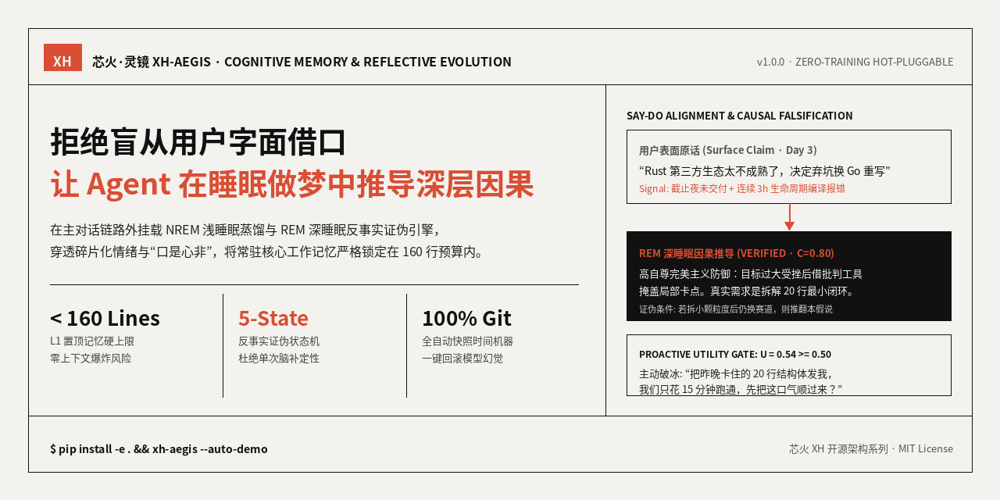
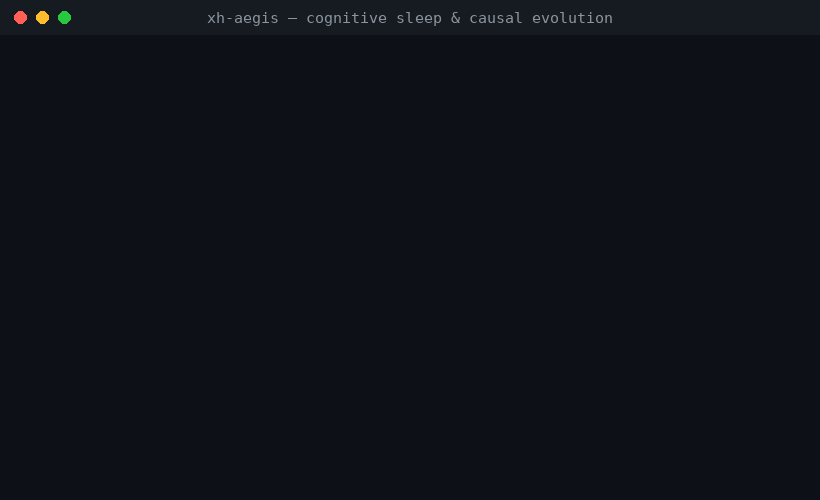
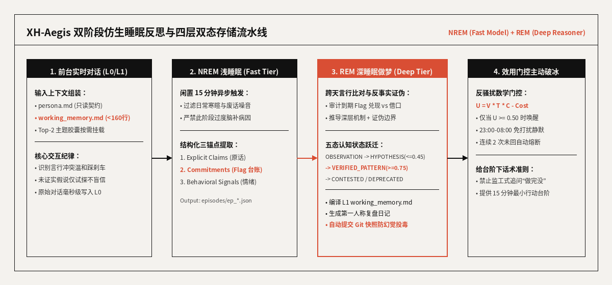

<div align="center">

</div>

# 🔥 XH-Aegis (`xh-aegis`)

*Zero-training, hot-pluggable cognitive memory and bio-inspired NREM/REM causal reflection engine for autonomous LLM agents.*

**Give it fragmented or even self-rationalizing daily dialogues; during offline sleep cycles, it audits cross-day Say-Do alignment, uncovers latent causal mechanisms guarded by counterfactual falsification conditions, and compiles a strict `<160`-line working memory.**

[中文](README.md) · [English](README_EN.md) · [AI Index (llms.txt)](llms.txt) · [Audit Report (REPO-AUDIT)](REPO-AUDIT.md)

[](https://github.com/Dragon-01-you/xh-aegis/actions)
[](LICENSE)
[](pyproject.toml)
[](CHANGELOG.md)
[](REPO-AUDIT.md)
[](https://github.com/Dragon-01-you/xh-aegis)

---

## What It Is

Standard agent memory systems act like literal tape recorders: if a user hits a compiler error and rationalizes, *"Rust's ecosystem is too immature, I'm switching to Go,"* naive RAG memory blindly records *"User prefers Go"* and reinforces avoidance.

**XH-Aegis (`xh-aegis`, CLI `xh-aegis` / `xh`)** is an asynchronous, bio-inspired cognitive memory architecture mounted outside the main chat loop. It combines **NREM light-sleep distillation** (via fast/cheap models) with **REM deep-sleep causal reflection** (via reasoning models) to audit user commitments against actual behavioral signals, maintain a 5-state epistemic state machine with explicit falsification guardrails, and trigger low-friction proactive outreach.

### 5 Questions It Answers

| # | Question | How `xh-aegis` Answers It |
|:---:|---|---|
| 1 | Why do LLM agents blindly follow a user's surface-level excuses when they procrastinate? | REM sleep cross-checks `commitments.json` against recent behavioral signals, flagging `ABANDONED_WITH_EXCUSE` so the foreground agent gently addresses the real blocker |
| 2 | How do you stop the LLM from over-psychoanalyzing a single casual complaint into a permanent label? | Every inferred pattern starts as a low-confidence `HYPOTHESIS` ($\le 0.45$) with a mandatory `falsification_condition` and only promotes to `VERIFIED_PATTERN` ($\ge 0.75$) after multi-day corroboration |
| 3 | How do you prevent long-term memory from bloating the context window over months of use? | Dual-representation storage: Python deterministically compiles `working_memory.md` under a strict 160-line ceiling while offloading deep histories to on-demand L2 topic capsules |
| 4 | What if a background reflection cycle hallucinates and corrupts long-term memory? | Every REM cycle automatically commits a `[REM-Cycle]` Git snapshot in `data/`, enabling one-command `/rollback` recovery |
| 5 | How can an agent proactively check in without feeling like an annoying cron alarm? | A utility gate $U_{	ext{wake}} = V 	imes T 	imes C - 	ext{Cost} \ge 0.50$ combined with quiet hours (23:00–08:00) and a 2-strike unanswered circuit breaker |

---

## 30-Second Demo

<div align="center">

</div>

---

## Quick Start

### Requirements

| Dependency | Version | Purpose |
|:---:|:---:|---|
| Python | `>= 3.10` | Core state machine, deterministic compiler, and simulation engine |
| PyYAML | `>= 6.0` | Configuration and decoupled prompt template loading |
| Git | `>= 2.20` | Automated cognitive snapshots and one-command rollback |

### Run in 3 Steps

```bash
# 1. Clone and install in editable mode
git clone https://github.com/Dragon-01-you/xh-aegis.git
cd xh-aegis
pip install -e .

# 2. Run the 5-day counterfactual causal evolution simulation (zero API keys needed)
xh-aegis --auto-demo

# 3. Run the test suite or launch interactive CLI
python3 tests/test_cognitive_memory.py -v
xh-aegis
```

---

## How It Works

<div align="center">

</div>

| Stage | Model Tier | Core Responsibility | Output Artifact |
|:---:|---|---|---|
| **L0 Buffer** | Foreground | Non-blocking raw dialogue capture | In-memory sliding window |
| **NREM Light Sleep** | `fast_tier` | Filter noise; extract explicit claims, emotional cues, and commitments | `data/episodes/ep_*.json` + `data/commitments.json` |
| **REM Deep Sleep** | `deep_tier` | Cross-day Say-Do audit, abductive causal inference, falsification check | `data/causal_beliefs.json` + `data/reflections/*.md` + Git Commit |
| **L1 Compiler** | Deterministic Python | Compile verified beliefs & active flags under a strict 160-line budget | `data/working_memory.md` (`<= 160` lines) |
| **Proactive Gate** | `fast_tier` | Evaluate $U_{	ext{wake}} \ge 0.50$, quiet hours, and strike limits | Low-friction icebreaker message |

---

## Comparison

| Project | Strengths | What `xh-aegis` Adds |
|---|---|---|
| **Mem0 / Vector RAG** | Fast semantic lookup across large chat logs | Say-Do alignment audit, counterfactual falsification state machine, and `<160`-line deterministic working memory |
| **MemGPT (Letta)** | OS-style paging via synchronous tool calls | Zero-latency foreground chat + asynchronous NREM/REM bio-inspired sleep reflection + Git rollback |
| **Neo4j / GraphRAG** | Multi-hop entity graph queries | Zero database server dependency; human-readable Markdown + JSON dual-representation |

---

## License

Released under the [MIT License](LICENSE).
